<!-- Header -->
<p align="center">
  
</p>

<p align="center">
  <a href="https://git.io/typing-svg">
    
  </a>
</p>

<p align="center">
  <a href="https://port-folio-bice-nine.vercel.app/"></a>
  <a href="mailto:manhdatvbhp@gmail.com"></a>
  
</p>

<p align="center">
  
</p>

---

### 🛡️ About me

```yaml
name: Nguyen Manh Dat
role: DevSecOps Intern @ VNPT Cyber Immunity
education: PTIT — Information Technology (2024 - 2028)
location: Ha Noi, Viet Nam 🇻🇳
focus:
  - Secure CI/CD pipelines (SAST, image & dependency scanning, security gates)
  - GitOps delivery on Kubernetes with ArgoCD
  - Centralized logging, SIEM & threat detection
  - Infrastructure automation with Ansible
currently_learning: [Kubernetes security, Detection engineering, Incident response]
```

---

### 🧰 Tech stack

**☸️ Cloud Native & GitOps**
<p>
  
  
  
  
  
</p>

**🔄 CI/CD & Automation**
<p>
  
  
  
  
  
</p>

**🛡️ Security**
<p>
  
  
  
  
  
  
</p>

**📊 Monitoring, Logging & SIEM**
<p>
  
  
  
  
  
  
</p>

**🗄️ Database & OS**
<p>
  
  
  
  
  
  
</p>

---

### 🚀 Featured projects

| Project | What it does | Stack |
|---|---|---|
| 🔁 [**GitOps CI/CD on K8s**](https://github.com/nguyenmanhdat006/cluster_k8s_argocd) | Jenkins pipeline from GitLab with SonarQube SAST + Trivy scanning, security gate blocking HIGH/CRITICAL, ArgoCD auto-sync to Kubernetes | Jenkins · SonarQube · Trivy · ArgoCD · K8s |
| 🐘 [**Ansible HA PostgreSQL**](https://github.com/nguyenmanhdat006/ansible-ha-postgres) | 3-node PostgreSQL HA cluster with automatic failover in ~10s, fully provisioned by Ansible | Patroni · etcd · HAProxy · Ansible |
| 🚨 **Web Attack SIEM & Detection** | Log pipeline normalized to ECS, detection rules for Brute Force (T1110) & SQLi (T1190), real-time Telegram alerts in < 1 min | Elasticsearch · Vector · Kibana · DVWA |
| 📜 **Centralized Logging & DB Audit** | Grok parsing for HAProxy & PostgreSQL logs, audit of DROP/DELETE/GRANT, failed logins and slow queries | ELK · Filebeat · Grok |
| 🌐 [**Calico Network Policy**](https://github.com/nguyenmanhdat006/CALICO-NETWORK-POLICY) | Zero-trust network segmentation for Kubernetes workloads | Calico · K8s |

---

### 📈 GitHub stats

<p align="center">
  
</p>

<!-- Snake animation: requires .github/workflows/snake.yml -->
<p align="center">
  <picture>
    <source media="(prefers-color-scheme: dark)" srcset="https://raw.githubusercontent.com/nguyenmanhdat006/nguyenmanhdat006/output/github-snake-dark.svg" />
    
  </picture>
</p>

---

<p align="center">
  <i>"Security is not a stage in the pipeline — it is the pipeline."</i>
</p>

